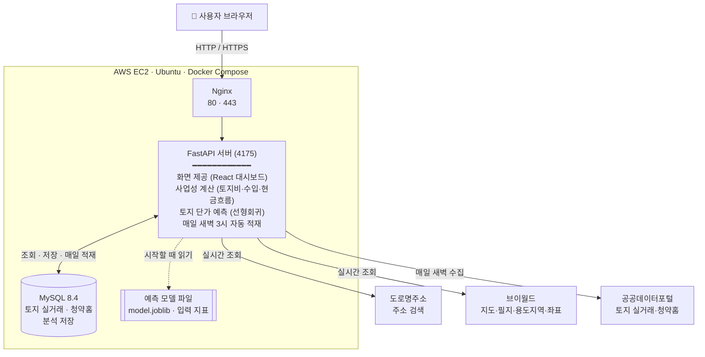

# 부동산 PF

> **KB-Bridge 1기 광주캠퍼스 3조** 프로젝트

## 팀 소개

| 이름 | 담당 역할 |
|---|---|
|  |  |
|  |  |
|  |  |
|  |  |

## 프로젝트 소개

땅(필지)을 고르면 토지·건축물·규제·주변 입지 정보를 모으고, 토지 실거래·분양 사례로 **개발해서 팔면 이익이 남는지(사업성)** 계산해 주는 웹 프로그램이다. 안산 장상동 27필지의 저장 예시가 들어 있다.

## 기술 스택

| 구분 | 사용 기술 | 용도 |
|---|---|---|
| 백엔드 | Python 3.12, FastAPI, Uvicorn | 웹 서버, 공공 API 호출, 사업성 계산 |
| DB | MySQL 8.4 (Docker), SQLAlchemy, PyMySQL | 토지 실거래·청약홈 분양정보 적재, 분석 결과 저장 |
| 공간 계산 | Shapely, pyproj | 필지 경계와 용도지역 경계를 겹쳐 면적 배분 |
| 예측 모델 | scikit-learn 선형회귀 (예전 모델: CatBoost) | 토지 그룹(시군구·지목·용도지역)의 6개월 뒤 단가 예측 |
| 프론트엔드 | React 19, Vite, Recharts | 대시보드 화면과 차트 |
| 배포 | Docker Compose, Nginx, AWS EC2 (Ubuntu) | 컨테이너 실행, 80·443 포트 연결 |
| 기타 | Git LFS | 용량이 큰 예전 CatBoost 모델 파일(`model.cbm`) 관리 |

## 시스템 구성도



- 사용자는 80·443 포트로 접속하고, Nginx가 요청을 FastAPI 서버로 넘긴다.
- 토지 실거래·청약홈 분양정보는 매일 새벽 공공데이터포털에서 받아 MySQL에 쌓아 두고, 화면 요청 때는 DB에서 읽는다.
- 지도·필지·주소는 화면 요청 때마다 브이월드·도로명주소 API를 바로 부른다.
- 예측 모델은 서버가 켜질 때 한 번 읽어 둔다.

## 사용한 공공 API

| 제공처 | API | 이 프로젝트에서 쓰는 곳 |
|---|---|---|
| [브이월드(VWorld)](https://www.vworld.kr/) | 지도·데이터 API | 위성지도, 연속지적도·필지 경계, 용도지역 경계, 토지대장·토지이용계획·토지특성·건축물·개별공시지가 |
| | [Geocoder](https://www.vworld.kr/dev/v4dv_geocoderguide2_s001.do) | 분양 비교단지 주소 → 좌표 변환 |
| | [Search](https://www.vworld.kr/dev/v4dv_search2_s001.do) | 학교·산·하천·산업단지 등 주변시설 검색 |
| [공공데이터포털](https://www.data.go.kr/) | [국토교통부 토지 매매 실거래가](https://www.data.go.kr/data/15126466/openapi.do) | 토지 비교사례 (10년치를 DB에 적재, 매일 새벽 최근 3개월 갱신) |
| | [한국부동산원 청약홈 분양정보](https://www.data.go.kr/data/15098547/openapi.do) | 아파트 분양가·공급면적 비교사례 (DB에 적재, 매일 갱신) |
| [주소기반산업지원서비스](https://business.juso.go.kr/) | 도로명주소 검색 API | 주소 검색, 법정동·지번 확인 |
| [행정표준코드관리시스템](https://www.code.go.kr/) | 법정동 코드 (내려받기) | 전국 시군구·법정동 목록. 인증키 필요 없음 |

예측 모델의 입력 지표(지가변동률, 건축허가면적, COFIX, 경제심리지수, 동행지수, M1, 비은행 주택관련대출)는 API로 부르지 않는다. 팀에서 내려받아 가공한 파일을 `data/models/inputs/`에 넣어 쓴다.

## 프로젝트 구조

```
.
├─ server/                 Python 서버 (FastAPI)
│   ├─ main.py             서버 조립 (DB 연결, 기능 등록)
│   ├─ features/           기능별 URL 창구 (분석 저장, 공공데이터 조회, 모델 예측, 매일 자동 적재 등)
│   └─ domain/             공공 API 연결, 토지 분류·면적 배분
│       └─ analysis/       사업성 계산 (수입·토지비·비용·현금흐름)
├─ frontend/               React 화면 소스
│   └─ build/V6.template.html   완성된 화면 파일 (서버가 브라우저로 보냄)
├─ data/
│   ├─ samples/            기본 제공 예시 분석 (안산 장상동 27필지)
│   └─ models/             토지 단가 예측 모델 (선형회귀, 예전 CatBoost)과 입력 자료
├─ deploy/nginx.conf       배포 서버용 Nginx 설정 (80·443 포트)
├─ certs/                  HTTPS 인증서 자리 (git 제외)
├─ tests/                  자동 테스트
├─ docs/                   설명 문서
├─ Dockerfile              서버 이미지 만드는 방법
├─ docker-compose.yml      컨테이너 실행 설정
└─ requirements.txt        Python 라이브러리 목록
```

## 배포 방법

Ubuntu 서버(AWS EC2)에 Docker로 올린다. 밖으로 여는 포트는 **80(HTTP)·443(HTTPS)** 두 개이고,
앱(4175)과 MySQL(3306)은 서버 안에서만 쓴다. 80·443으로 들어온 요청은 Nginx 컨테이너가 받아 앱에 넘긴다.

### 1. 준비물

- Docker, Docker Compose, Git, **Git LFS** (예전 CatBoost 모델 `model.cbm`이 LFS로 올라가 있음. 지금 쓰는 선형회귀 모델은 일반 파일이라 LFS 없이도 받아짐)
- 보안 그룹에서 80·443 포트 열기 (로그인 기능이 없으므로 접속 허용 IP를 제한하는 것을 권장)
- 공공 API 키: 브이월드, 공공데이터포털, 도로명주소

### 2. 처음 한 번

```bash
# 코드와 모델 파일 받기
sudo apt install -y git-lfs && git lfs install
git clone https://github.com/ssun4098/real-estate-price-prediction.git v6
cd v6
git lfs pull
ls -l data/models/model.cbm          # 110489296 바이트면 정상 (100~200 바이트면 LFS 안내 파일만 받은 것)

# MySQL 8.4 컨테이너(land-mysql)를 앱과 같은 네트워크에 연결
sudo docker network create v6_mysql
sudo docker network connect v6_mysql land-mysql

# 설정 파일 만들기
cp .env.example .env
vi .env
```

`.env`에서 꼭 채울 값:

| 항목 | 값 |
|---|---|
| `MYSQL_USER`, `MYSQL_PASSWORD`, `MYSQL_DATABASE` | 서버 MySQL 계정과 데이터베이스 |
| `VWORLD_API_KEY`, `DATA_GO_KR_API_KEY`, `JUSO_API_KEY` | 공공 API 키 |
| `VWORLD_DOMAIN` | 서버 접속 주소 (예: `http://서버IP`). 브이월드에 등록한 서비스 주소와 같아야 함 |
| `MODEL_ENTRYPOINT` | `land_price_linear:LandPriceLinearPredictor` (예측 모델 켜기. 예전 CatBoost는 `land_price_model:LandPricePredictor`) |

토지 실거래(`land_trade`)·청약홈(`applyhome_apt_*`) 자료는 서버 MySQL에도 적재되어 있어야 한다. 이후에는 서버가 매일 새벽 3시에 최근 자료를 자동으로 갱신한다.

### 3. 실행

```bash
sudo docker compose --profile deploy up -d --build
```

- `--profile deploy`를 붙여야 Nginx(80·443)까지 함께 켜진다.
- 처음 켤 때 `certs/`에 시험용 HTTPS 인증서가 자동으로 만들어진다 (브라우저 경고가 뜨면 '계속 진행').
- 접속: `http://서버IP/` 또는 `https://서버IP/`

정상 확인:

```bash
curl -s http://127.0.0.1:4175/api/model/status      # "state":"ready" 이면 모델까지 정상
sudo docker compose logs -f api                      # 서버 로그
```

### 4. 수정 사항 반영

| 바뀐 것 | 명령 |
|---|---|
| 코드, `requirements.txt` | `git pull && git lfs pull` 후 `sudo docker compose --profile deploy up -d --build` |
| `.env` | `sudo docker compose --profile deploy up -d --force-recreate api` |
| 모델 파일 (`data/models/`) | `sudo docker compose restart api` |

모델은 서버가 켜질 때 한 번만 읽는다. 모델 파일만 바꾸고 `--build`로 다시 켜면 컨테이너가 그대로 남아 예전 상태가 유지되므로, 위 표처럼 `restart`를 쓴다.
